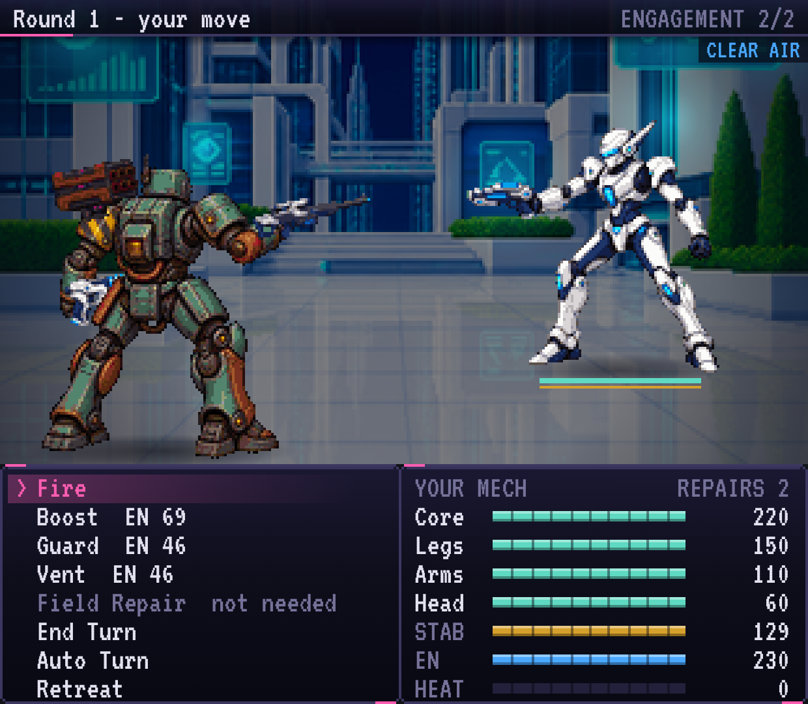
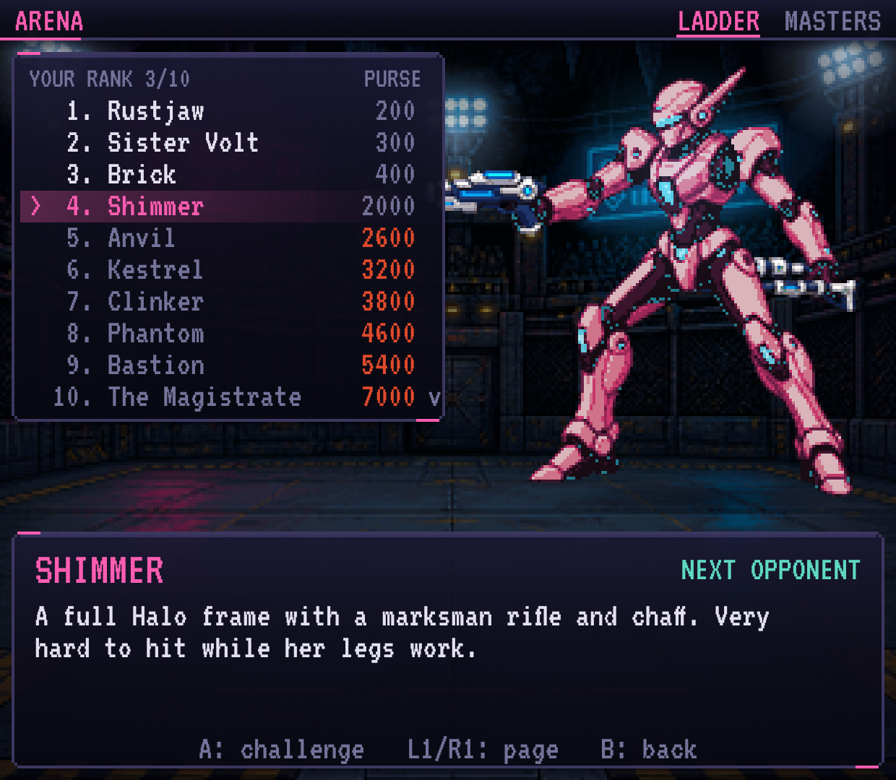

# IRONWAGE

Een beurtgebaseerde mech-RPG voor de Retroid Pocket Classic. Je bent een huurling in de
neonstad Varn: je stelt een mecha samen uit losse onderdelen, neemt contracten aan van drie
opdrachtgevers, en betaalt munitie en reparaties uit je eigen loon.



## Spelen

De nieuwste Android-versie staat onder [Latest build](../../releases/tag/latest-build) als
`ironwage.apk`. Zet het bestand op het toestel en open het om te installeren. Een uitgebreide
uitleg staat in de [handleiding](docs/handleiding.md).

| Knop | Functie |
|---|---|
| D-pad | Kiezen |
| A | Bevestigen |
| B | Terug |
| L1 / R1 | Bladeren: pagina's, tabbladen, verf in de garage, doelwit in een gevecht |
| Links / rechts | In de winkel wisselen tussen de koop- en de verkooplijst, in een gevecht van doelwit wisselen |
| Start | Invoer-venster aan of uit (toont de code van elke knop en de grootte waarop het spel getekend wordt) |

Zitten A en B op jouw toestel andersom? Zet onder **Options** de regel **A/B Buttons** op
**Swapped**. Op een computer: pijltjestoetsen, Enter, Escape, Q/E en spatie.

## Wat er in zit

- **Mecha**: elf sloten (kop, romp, armen, benen, generator, booster, vuurleiding, module, twee
  handen, schouder) en 133 onderdelen in de winkel. Het gewicht mag het draagvermogen van de benen
  niet overschrijden en de generator moet alles kunnen voeden. Twaalf verfschema's, acht die je in
  de arena verdient, en zeven opgeslagen builds. Je begint in een van drie mecha's naar keuze.
- **Zeven klassen**: elke build is een Duellist, Sharpshooter, Artillery, Lancer, Bastion,
  Skirmisher of All-rounder. De garage zegt welke, het pilotenscherm houdt bij wat je als elke
  klasse hebt gewonnen en stelt een build voor die je nu kunt kopen. Met elk van de zeven is het
  hele verhaal uit te spelen.
- **Op maat**: bij de briefing kies je in welke van je bewaarde builds je vertrekt, en het spel
  rekent voor die build je winkans uit (het vliegt het contract twintig keer zelf, met al jouw
  perks, werkbank, Overdrive en wingman). Een van de open contracten zoekt telkens een klasse en
  betaalt een kwart meer als je het in zo'n build wint.
- **Proefveld**: in de simulator probeer je je eigen build gratis uit tegen elke machine die je
  al bent tegengekomen, of je spart tegen een van je eigen bewaarde builds; na afloop zie je wat
  een echte vlucht had gekost.
- **Soorten werk**: naast de drie open contracten staat er steeds een klus die om iets anders
  vraagt: één doelwit uitschakelen, een machine heel terugbrengen, vracht beschermen of zes rondes
  standhouden. Welke build je meeneemt maakt daar echt verschil.
- **In beeld**: wat je bij een escorte beschermt staat echt op het veld (een loonwagen, een
  ertstrein, een colonne). Je ziet het geraakt worden, roken als er nog een derde over is, en de
  lucht in gaan als je het verliest.
- **Hangar**: zeven plekken voor bewaarde builds in plaats van drie, genoeg voor een build van
  elke klasse; de garage noemt elke plek naar de klasse van de build die erin zit.
- **Meesters**: de arena heeft een tweede pagina met zeven meesters, een per klasse. Versla je er
  een in een build van zijn eigen klasse, dan is de kroon van die klasse van jou. Een kroon geeft
  je de titel en de lak van de meester, en contracten die die klasse zoeken betalen je de helft
  extra in plaats van een kwart.
- **De achtste stoel**: onder de zeven meesters staat een achtste rij. Wie alle zeven kronen heeft,
  mag de houder van die stoel uitdagen, in welke build ook. Zijn machine, de Sovereign, vecht op
  drie manieren en wisselt als hij geraakt wordt. Win je, dan mag je de Sovereign zelf kopen en is
  de lak van de houder van jou.
- **Gevecht**: per beurt besteed je energie aan vuren, boosten, bewaken, koelen, je module of een
  noodreparatie. Je mikt op onderdelen; zware treffers brengen een mecha uit evenwicht. Er zijn
  zwaarden, wapens die een beurt opladen, salvo's, schilden en vijf soorten benen.
- **Vijanden**: 47 soorten, waaronder drones die de rest afdekken of repareren, stoorzenders,
  lopende bommen, dragers, benoemde piloten en eindbazen die halverwege van tactiek veranderen.
- **Campagne**: drie bedrijven, 29 verhaalcontracten waarvan één piloot er achttien speelt, drie
  opdrachtgevers, twee slotkeuzes en zes eindes. Contracten hebben doelen (overleven, beschermen,
  uitschakelen zonder te vernietigen, verjagen) en een rang van S tot D. Gespeelde contracten staan
  in een archief.
- **Arena**: een ladder van tien piloten, een achterkamer met vijf voor de kampioen, en een
  spiegelgevecht tegen je eigen mecha. Na het verhaal: twee duels, elk om een mecha die je
  daarna zelf mag kopen.
- **Training**: dertien oefeningen in een geleende mecha die elk één ding uitleggen.
- **Piloot**: niveaus en acht vaardigheden, 69 medailles en een logboek.
- **Database**: een fiche per vijand die je bent tegengekomen, de achtergrond van de stad en de
  spelregels.
- **Verder**: losse contracten die meegroeien, een nieuwe ronde na het einde, drie opslagplekken,
  drie moeilijkheden, muziek per scherm (zestien nummers, zonder audiobestanden), trillen bij zware
  treffers, en een schuldplafond zodat een reeks nederlagen nooit het einde van een spel is.



## Ontwikkelen

```bash
npm install
```

```bash
npm run dev
```

| Opdracht | Doet |
|---|---|
| `npm test` | Tests op de spelregels, de inhoud en de schermlogica |
| `npm run e2e` | Browsertests die het spel met het toetsenbord doorspelen |
| `SOAK=1 npm run e2e -- e2e/soak.spec.ts --workers 2` | Duurproef: vijf robotspelers spelen het spel door met alles getekend, in een echte browser, en melden alles wat het tekenvlak weigert. Duurt een kwartier (`SOAK_MINUTES` stelt de speeltijd per speler in) |
| `npm run typecheck` | Typecontrole |
| `npm run simulate -- --table` | Speelt elk contract honderden keren automatisch en toont de winstkans per referentiebuild (`--arena`, `--board`, `--cycle 1`, `--why`) |
| `npm run career -- --all` | Laat een piloot hele loopbanen zelf uitspelen: elke route, elke moeilijkheid. Hij vecht alleen met Auto Turn en koopt onderdelen via de spelregels, niet via de winkelschermen |
| `npm run build` | Bouwt de webversie in `dist/` |

De APK wordt bij elke push gebouwd door de workflow in `.github/workflows/android.yml`.

## Opbouw

| Map | Inhoud |
|---|---|
| `src/core` | Spelregels zonder beeld of opslag: gevecht, builds, economie, campagne, rangen, piloot, medailles, arena, training, database, contractbord |
| `src/content` | Onderdelen, vijanden, contracten, scènes, berichten, medailles, oefeningen, database, liedjes en alle speltekst |
| `src/ui` | Schermen: per scherm een logicaklasse en een tekenklasse |
| `src/platform` | Invoer, geluid, muziek en opslag |
| `scripts/art` | Beeld genereren en verwerken tot sprites |
| `android` | De Android-schil (Capacitor) |
| `docs/superpowers` | Het ontwerp en de bouwplannen |

## Beeld

Elke mecha-familie is één complete tekening in een vaste houding, die in vijf lagen is
geknipt. Omdat alle families dezelfde houding delen, passen lagen van verschillende families
op elkaar. De prompts staan in `scripts/art/jobs.ts`, en bij elke afbeelding in `art/raw`
staat een bestand met de prompt waarmee ze is gemaakt.

```bash
ART_PROXY_URL=<adres van de beeldproxy> npx tsx scripts/art/generate.ts
```

```bash
npx tsx scripts/art/process.ts
```

Het adres van de proxy en de sleutel staan niet in de repository.
