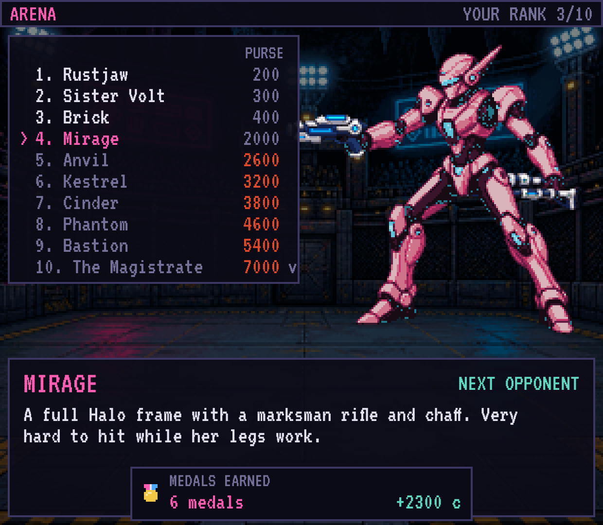

# IRONWAGE

Een beurtgebaseerde mech-RPG voor de Retroid Pocket Classic. Je bent een huurling in de
neonstad Varn: je stelt een mecha samen uit losse onderdelen, neemt contracten aan van drie
opdrachtgevers, en betaalt munitie en reparaties uit je eigen loon.


## Spelen

De nieuwste Android-versie staat onder [Latest build](../../releases/tag/latest-build) als
`ironwage.apk`. Zet het bestand op het toestel en open het om te installeren. Een uitgebreide
uitleg staat in de [handleiding](docs/handleiding.md).

| Knop | Functie |
|---|---|
| D-pad | Kiezen |
| A | Bevestigen |
| B | Terug |
| L1 / R1 | Bladeren: pagina's, tabbladen, verf in de garage, doelwit in een gevecht |
| Links / rechts | In de winkel wisselen tussen de koop- en de verkooplijst, in een gevecht van doelwit wisselen |
| Start | Invoer-venster aan of uit (toont de code van elke knop en de grootte waarop het spel getekend wordt) |

Zitten A en B op jouw toestel andersom? Zet onder **Options** de regel **A/B Buttons** op
**Swapped**. Op een computer: pijltjestoetsen, Enter, Escape, Q/E en spatie.

## Wat er in zit

- **Mecha**: elf sloten (kop, romp, armen, benen, generator, booster, vuurleiding, module, twee
  handen, schouder) en 112 onderdelen in de winkel. Het gewicht mag het draagvermogen van de benen
  niet overschrijden en de generator moet alles kunnen voeden. Twaalf verfschema's en drie
  opgeslagen builds.
- **Gevecht**: per beurt besteed je energie aan vuren, boosten, bewaken, koelen, je module of een
  noodreparatie. Je mikt op onderdelen; zware treffers brengen een mecha uit evenwicht. Er zijn
  zwaarden, wapens die een beurt opladen, salvo's, schilden en vijf soorten benen.
- **Vijanden**: dertig soorten, waaronder drones die de rest afdekken of repareren, stoorzenders,
  lopende bommen, dragers, benoemde piloten en eindbazen die halverwege van tactiek veranderen.
- **Campagne**: drie bedrijven, 29 verhaalcontracten waarvan één piloot er achttien speelt, drie
  opdrachtgevers, twee slotkeuzes en zes eindes. Contracten hebben doelen (overleven, beschermen,
  uitschakelen zonder te vernietigen, verjagen) en een rang van S tot D. Gespeelde contracten staan
  in een archief.
- **Arena**: een ladder van tien piloten, een achterkamer met vijf voor de kampioen, en een
  spiegelgevecht tegen je eigen mecha.
- **Training**: tien oefeningen in een geleende mecha die elk één ding uitleggen.
- **Piloot**: niveaus en acht vaardigheden, 45 medailles en een logboek.
- **Database**: een fiche per vijand die je bent tegengekomen, de achtergrond van de stad en de
  spelregels.
- **Verder**: losse contracten die meegroeien, een nieuwe ronde na het einde, drie opslagplekken,
  drie moeilijkheden, muziek per scherm (tien nummers, zonder audiobestanden), trillen bij zware
  treffers, en een schuldplafond zodat een reeks nederlagen nooit het einde van een spel is.



## Ontwikkelen

```bash
npm install
```

```bash
npm run dev
```

| Opdracht | Doet |
|---|---|
| `npm test` | Tests op de spelregels, de inhoud en de schermlogica |
| `npm run e2e` | Browsertests die het spel met het toetsenbord doorspelen |
| `npm run typecheck` | Typecontrole |
| `npm run simulate -- --table` | Speelt elk contract honderden keren automatisch en toont de winstkans per referentiebuild (`--arena`, `--board`, `--cycle 1`, `--why`) |
| `npm run career -- --all` | Laat een piloot hele loopbanen zelf uitspelen: elke route, elke moeilijkheid. Hij vecht alleen met Auto Turn en koopt onderdelen via de spelregels, niet via de winkelschermen |
| `npm run build` | Bouwt de webversie in `dist/` |

De APK wordt bij elke push gebouwd door de workflow in `.github/workflows/android.yml`.

## Opbouw

| Map | Inhoud |
|---|---|
| `src/core` | Spelregels zonder beeld of opslag: gevecht, builds, economie, campagne, rangen, piloot, medailles, arena, training, database, contractbord |
| `src/content` | Onderdelen, vijanden, contracten, scènes, berichten, medailles, oefeningen, database, liedjes en alle speltekst |
| `src/ui` | Schermen: per scherm een logicaklasse en een tekenklasse |
| `src/platform` | Invoer, geluid, muziek en opslag |
| `scripts/art` | Beeld genereren en verwerken tot sprites |
| `android` | De Android-schil (Capacitor) |
| `docs/superpowers` | Het ontwerp en de bouwplannen |

## Beeld

Elke mecha-familie is één complete tekening in een vaste houding, die in vijf lagen is
geknipt. Omdat alle families dezelfde houding delen, passen lagen van verschillende families
op elkaar. De prompts staan in `scripts/art/jobs.ts`, en bij elke afbeelding in `art/raw`
staat een bestand met de prompt waarmee ze is gemaakt.

```bash
ART_PROXY_URL=<adres van de beeldproxy> npx tsx scripts/art/generate.ts
```

```bash
npx tsx scripts/art/process.ts
```

Het adres van de proxy en de sleutel staan niet in de repository.
