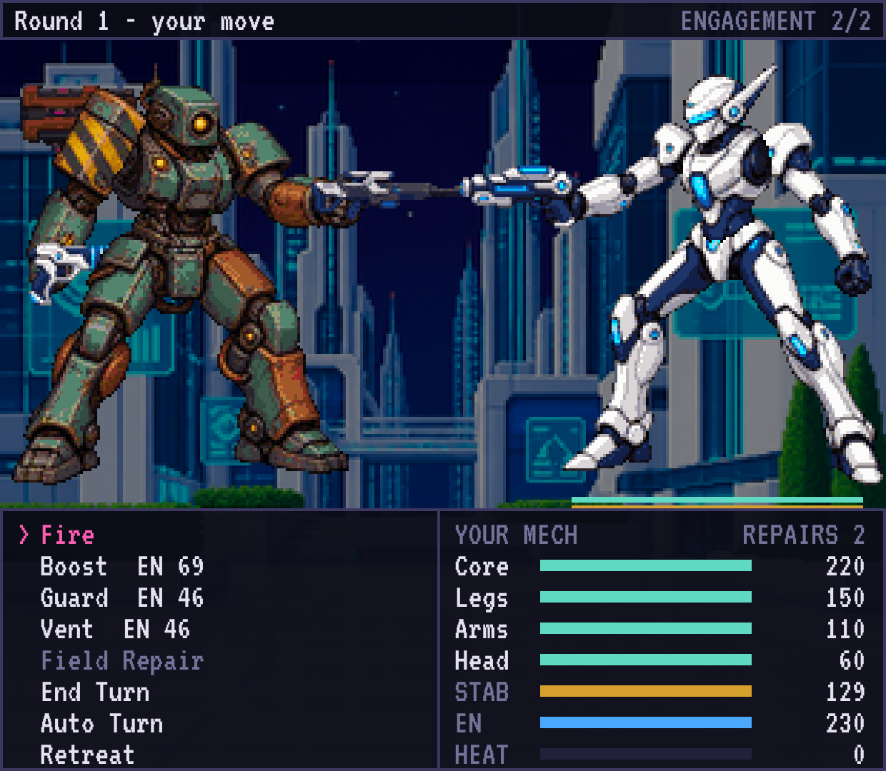

# IRONWAGE

Een beurtgebaseerde mech-RPG voor de Retroid Pocket Classic. Je bent een huurling in de
neonstad Varn: je stelt een mecha samen uit losse onderdelen, neemt contracten aan van drie
opdrachtgevers, en betaalt munitie en reparaties uit je eigen loon.



## Spelen

De nieuwste Android-versie staat onder [Latest build](../../releases/tag/latest-build) als
`ironwage.apk`. Zet het bestand op het toestel en open het om te installeren.

| Knop | Functie |
|---|---|
| D-pad | Kiezen |
| A | Bevestigen |
| B | Terug |
| L1 / R1 | Vorige of volgende categorie in de winkel, of doelwit in een gevecht |
| Links / rechts | Kopen of verkopen in de winkel, of van doelwit wisselen |
| Start | Invoer-venster aan of uit (toont de code van elke knop) |

Op een computer: pijltjestoetsen, Enter, Escape, Q/E en spatie.

## Hoe het spel werkt

- **Mecha**: acht sloten (kop, romp, armen, benen, generator, twee handwapens, een
  schouderwapen). Het gewicht mag het draagvermogen van de benen niet overschrijden, en de
  generator moet je wapens kunnen voeden.
- **Gevecht**: per beurt besteed je energie aan vuren, boosten, koelen of een noodreparatie.
  Je mikt op een onderdeel: zonder benen kan een vijand niet ontwijken, zonder armen vallen
  zijn handwapens uit, zonder kop raakt hij slecht, en zonder romp is hij vernietigd.
- **Hitte**: elk schot maakt je mecha warmer. Boven de 100 val je een beurt stil.
- **Geld**: na een contract krijg je je loon, min munitie en reparaties. Verkopen levert de
  volle prijs op, dus experimenteren kost niets.
- **Campagne**: twee introducties, daarna drie opdrachtgevers in vrije volgorde, dan één
  exclusief contract dat de andere twee uitsluit, en de finale van de gekozen opdrachtgever.
  Er zijn drie eindes. De patrouille is altijd beschikbaar.

## Ontwikkelen

```bash
npm install
```

```bash
npm run dev
```

| Opdracht | Doet |
|---|---|
| `npm test` | Tests op de spelregels, de inhoud en de schermlogica |
| `npm run e2e` | Browsertests die het spel met het toetsenbord doorspelen |
| `npm run typecheck` | Typecontrole |
| `npm run simulate -- --all` | Speelt elk contract honderden keren automatisch en toont winstkans en opbrengst |
| `npm run build` | Bouwt de webversie in `dist/` |

De APK wordt bij elke push gebouwd door de workflow in `.github/workflows/android.yml`.

## Opbouw

| Map | Inhoud |
|---|---|
| `src/core` | Spelregels zonder beeld of opslag: gevecht, builds, economie, campagne |
| `src/content` | Onderdelen, vijanden, contracten, berichten en alle speltekst |
| `src/ui` | Schermen: per scherm een logicaklasse en een tekenklasse |
| `src/platform` | Invoer, geluid en opslag |
| `scripts/art` | Beeld genereren en verwerken tot sprites |
| `android` | De Android-schil (Capacitor) |
| `docs/superpowers` | Het ontwerp en de bouwplannen |

## Beeld

Elke mecha-familie is één complete tekening in een vaste houding, die in vijf lagen is
geknipt. Omdat alle families dezelfde houding delen, passen lagen van verschillende families
op elkaar. De prompts staan in `scripts/art/jobs.ts`, en bij elke afbeelding in `art/raw`
staat een bestand met de prompt waarmee ze is gemaakt.

```bash
ART_PROXY_URL=<adres van de beeldproxy> npx tsx scripts/art/generate.ts
```

```bash
npx tsx scripts/art/process.ts
```

Het adres van de proxy en de sleutel staan niet in de repository.
